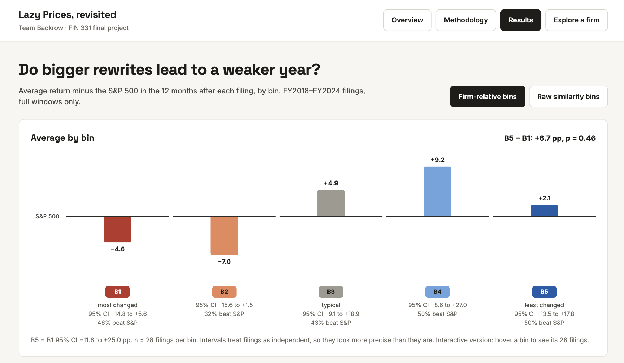
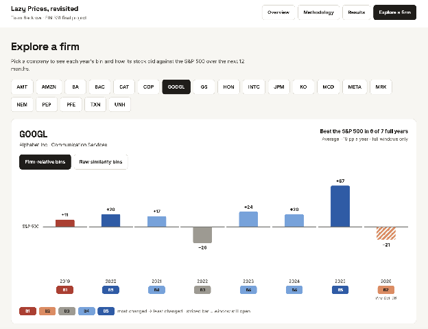

# Proposal: Lazy Prices, Revisited

**Team Backrow · FIN 331 · HW8**

## 1. The question

Do firms that make significant changes to the Risk Factors and MD&A sections of their 10-Ks underperform in the market? The people most likely to pay for the answer are hedge funds and other asset managers. They are always looking for an edge on the market, and this project could provide one based solely on SEC material.

## 2. The data

The unit of observation is a firm-fiscal-year: one original 10-K, compared with the same firm's 10-K from the year before and joined to the stock's return over the 12 months after the filing. Each row identifies the firm by ticker, company name, SEC number (CIK) and sector, and gives the fiscal year, the prior fiscal year it is compared to and the date the filing was made. For the signal, it has the cosine similarity for the Risk Factors and Management's Discussion and Analysis sections combined and for each one separately, with Jaccard similarity as a robustness check. It also has the change score, calculated as one minus similarity, the firm's median change in earlier years, the relative change and the quintile bin for the year, where bin 1 is the most changed. For the outcome, it has the window start and end dates, the firm's 12-month return, the S&P 500's return over the same window, the excess return and an indicator for whether the 12-month window is not finished yet.

**Sample rows** (real rows from the v0 pipeline, `app_data/firm_years.csv`; a selection of columns):

| ticker | fy | filing_date | cosine_sim | change | rel_change | bin | window_start | window_end | firm_return_pct | spy_return_pct | excess_return_pct | partial |
|---|---|---|---|---|---|---|---|---|---|---|---|---|
| AMT | 2018 | 2019-02-27 | 0.9982 | 0.0018 | 0.83 | 3 | 2019-02-28 | 2020-02-28 | 31.0 | 8.3 | 22.7 | False |
| AMT | 2019 | 2020-02-25 | 0.9981 | 0.0019 | 1.03 | 4 | 2020-02-28 | 2021-02-26 | -2.9 | 30.8 | -33.7 | False |
| AMT | 2020 | 2021-02-25 | 0.9961 | 0.0039 | 2.16 | 3 | 2021-02-26 | 2022-02-28 | 7.0 | 16.3 | -9.3 | False |
| AMT | 2023 | 2024-02-27 | 0.9984 | 0.0016 | 0.44 | 4 | 2024-02-29 | 2025-02-28 | 6.9 | 18.4 | -11.5 | False |
| AMT | 2025 | 2026-02-24 | 0.9963 | 0.0037 | 1.24 | 1 | 2026-02-27 | 2026-10-30 | 0.9 | 11.0 | -10.2 | True |

| Raw input | Source | How you get it | Where it lives in the repo |
| :---- | :---- | :---- | :---- |
| ticker | Hand-entered by the team | Typed into the config (20 firms) | `config.yaml`, `firms:` (`ticker:`) |
| name | Hand-entered by the team | Typed into the config | `config.yaml` (`name:`) |
| sector | Hand-entered by the team | Typed into the config | `config.yaml` (`sector:`) |
| fy | SEC 10-K filing header (period of report) | Parsed from each downloaded 10-K in step 1 (`make download`) | `data/filings_manifest.csv`, code in `src/pilot/t1_download.py` |
| filing_date | SEC 10-K filing header and EDGAR submissions JSON | Parsed from each downloaded 10-K in step 1 | `data/filings_manifest.csv`, code in `src/pilot/t1_download.py` |
| 10-K full text, behind `cosine_sim`, `jaccard_sim`, `cosine_risk_factors` and `cosine_mdna` | SEC EDGAR | `sec-edgar-downloader` fetches form 10-K by CIK in step 1 | `data/raw/sec-edgar-filings/{cik}/10-K/{accession}/full-submission.txt` |
| Monthly adjusted prices (`adj_close`), behind `firm_return_pct`, `spy_return_pct` and `excess_return_pct`. SPY is the S&P 500 benchmark. | Yahoo Finance | `yfinance` downloads daily adjusted closes by ticker and converts them to month-end in step 5 (`make returns`) | `data/prices_monthly.csv`, code in `src/pilot/t5_returns.py`, benchmark set in `config.yaml` (`benchmark_ticker: SPY`) |

## 3. The method

The pipeline runs in eight steps that match the files in `src/pilot/`, and `make all` runs them in order. `t1_download.py` pulls every original 10-K for fiscal years 2015 to 2025 from SEC EDGAR and records each filing's company, period and filing date. `t2_clean.py` and `t2_sections.py` strip each filing down to plain text and cut out Item 1A (Risk Factors) and Item 7 (Management's Discussion and Analysis). `t3_score.py` computes the cosine similarity of word counts between each year's sections and the prior year's. `t4_bins.py` turns that into a change score, divides it by the firm's median change in earlier years to get relative change, and ranks firms within each year into 5 quintiles. `t5_returns.py` uses monthly adjusted prices from Yahoo Finance to measure each firm's 12-month return starting at the end of the filing month, minus the S&P 500's return over the same period. `t6_plot.py` draws the firm, pooled, heatmap and basket graphs, and `t7_coverage.py` reports every gap in the data. `t8_diff.py` shows the actual sentences that were added and removed between two years.

## 4. Threats and checks

We noticed a few threats in how we calculate relative change and in the years we picked. The benchmark overlaps the sample, and the excess return assumes every stock moves one-for-one with the market. All of the firms we have selected so far are in the S&P 500, and subtracting the index's return treats every firm as having a beta of 1. This means that Coca-Cola and other low-beta firms will appear to do poorly in strong years without anything going wrong. If steady, low-beta firms tend to land in bin 5 and volatile firms in bin 1, the comparison between bins would partly reflect beta rather than the 10-K changes. To check this, we'll estimate each firm's beta from the 36 months before each filing and rerun the bin comparison on the firms' beta-adjusted returns.

Not necessarily a threat, but worth noting: in 2020 the SEC amended Regulation S-K, which forced most firms to rewrite the Risk Factors sections of their 10-Ks. Ranking within each year cancels the shared part of the shock, but the 2020 change is then present in every firm's baseline from 2021 onward.

Another threat we had to address is that relative change divides a firm's change this year by its usual change. For firms whose 10-Ks barely change from year to year, both numbers are close to zero. Dividing a few small edits in one year by a few small edits in another lets a handful of edited sentences produce a large ratio, so a firm can land in bin 1 even though it barely rewrote anything. To check this, we'll set a minimum on the usual change and see whether the same firms stay in bin 1 when we bin on raw similarity alone.

## 5. Dashboard mockup

The dashboard is live at https://team-backrow-final-project-ghs5gtuwudvjks7fkjquxn.streamlit.app/ (code: [`app.py`](../app.py)).

**Results tab:** average return over the S&P 500 by bin, with a switch between firm-relative and raw-similarity bins.

**Explore a firm tab:** pick a company to see each year's bin and how its stock did against the S&P 500 over the next 12 months.

